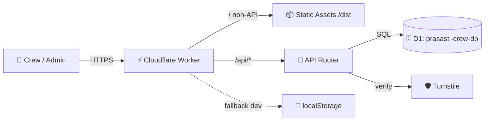

<div align="center">

# 🎭 PRASASTI CREW — Formulir Data Anggota

### Pendataan crew event yang cepat, aman, dan siap production.

**React 19 · Vite · Cloudflare Workers · D1 · Turnstile**

[](https://react.dev)
[](https://vitejs.dev)
[](https://workers.cloudflare.com)
[](https://developers.cloudflare.com/d1/)
[](LICENSE)

[🚀 Live Demo](https://prasasti-crew-form.ranggadhisesa.workers.dev) · [📖 Dokumentasi](#-dokumentasi) · [🐛 Laporkan Bug](../../issues) · [✨ Minta Fitur](../../issues)

</div>

---

## ✨ Kenapa project ini keren?

> Satu Worker melayani **frontend + API + database**. Tanpa backend terpisah, tanpa server yang harus dirawat. Deploy sekali, langsung live ke seluruh dunia via edge network Cloudflare.

<table>
<tr>
<td width="50%">

### 🧑‍🎤 Untuk Crew (Publik)
- 📝 Form multi-section dengan **progress bar & auto-save draft**
- 🔍 **Autofill crew** — ketik 2 huruf, data lama terisi otomatis
- 🏦 Combobox **100+ bank & e-wallet** Indonesia
- 🛡️ Proteksi **Cloudflare Turnstile** (anti-bot)
- 🚫 Cegah data ganda (nama + rekening unik per event)
- 📱 **Fully responsive** — mobile, tablet, desktop

</td>
<td width="50%">

### 🛠️ Untuk Admin / Finance
- 📊 **Ledger keuangan** — kelola nominal & status bayar (paid / pending)
- 🔎 Search + filter + tabel desktop & kartu mobile
- 📋 CRUD event (slug otomatis, buka/tutup form)
- 🔗 Link publik per event: `/{slug}` + halaman respon `/{slug}/respon`
- 🔐 Auth admin via Bearer token (session per-tab)
- ⚡ Edit nominal **auto-debounce 800ms**

</td>
</tr>
</table>

---

## 🖥️ Preview

> Ganti URL gambar di bawah dengan screenshot asli kamu (`docs/screenshot-*.png`).

<details open>
<summary><b>📸 Klik untuk lihat preview tampilan</b></summary>
<br>

| Landing Event | Form Publik | Admin Ledger |
|---|---|---|
|  |  |  |
| Pilih formulir yang dibuka | Isi data + Turnstile | Kelola event & pembayaran |

</details>

---

## 🧰 Tech Stack

| Layer | Teknologi |
|---|---|
| **Frontend** | React 19, Vite 8, Vanilla CSS (responsive, no framework CSS) |
| **Backend** | Cloudflare Worker (`worker/index.js`) — 1 file, ~460 baris |
| **Database** | Cloudflare D1 (SQLite edge) + migrasi SQL versioned |
| **Keamanan** | Turnstile anti-bot, Bearer admin token, timing-safe compare, validasi ganda client + server |
| **Fallback** | `localStorage` otomatis saat Worker tidak tersedia (`npm run dev`) |

---

## 🏗️ Arsitektur



**Routing frontend (SPA):**

| Route | Akses | Fungsi |
|---|---|---|
| `/` | Publik | Daftar event yang form-nya dibuka |
| `/:slug` | Publik | Formulir isi data crew |
| `/:slug/respon` | Publik | Daftar respon 1 event |
| `/admin` | 🔒 Admin | Dashboard + CRUD event |
| `/admin/event/:slug` | 🔒 Admin | Detail ledger keuangan per event |

---

## 🚀 Quick Start

<details open>
<summary><b>💻 Jalankan lokal (3 menit)</b></summary>

```bash
# 1. Clone & install
git clone <repo-kamu>.git
cd formv2
npm install

# 2a. Mode cepat (frontend saja, data di localStorage)
npm run dev

# 2b. Mode full (frontend + API + D1 lokal)
npm run dev:worker
```

Buka `http://localhost:5173` (Vite) atau `http://localhost:8787` (Worker).

> Password admin lokal: `lebahganteng`

</details>

<details>
<summary><b>☁️ Deploy ke Cloudflare (production)</b></summary>

```bash
# 1. Login & buat database (sekali saja)
npx wrangler login
npx wrangler d1 create prasasti-crew-db

# 2. Samakan database_id di wrangler.jsonc, lalu migrasi
npm run db:migrate

# 3. Set secret admin + turnstile
wrangler secret put ADMIN_TOKEN
wrangler secret put TURNSTILE_SECRET_KEY

# 4. Deploy!
npm run deploy
```

| Perintah | Fungsi |
|---|---|
| `npm run dev:worker` | Dev lokal full-stack |
| `npm run build` | Build Vite ke `dist/` |
| `npm run deploy` | Build + deploy production |
| `npm run db:migrate` | Migrasi D1 production (`--remote`) |
| `npm run db:migrate:local` | Migrasi D1 lokal |

</details>

---

## 🔌 API Reference

Base URL production: `https://prasasti-crew-form.ranggadhisesa.workers.dev`

Auth admin = header `Authorization: Bearer <ADMIN_TOKEN>`

| Metode | Path | Auth | Fungsi |
|---|---|---|---|
| `GET` | `/api/health` | — | Cek hidup |
| `GET` | `/api/turnstile/config` | — | Ambil site key widget |
| `GET` | `/api/events` | — | Daftar event |
| `POST` | `/api/events` | admin | Buat event |
| `PUT` | `/api/events/:id` | admin | Edit event |
| `DELETE` | `/api/events/:id` | admin | Hapus event + datanya |
| `GET` | `/api/events/:id/submissions` | — | Respon 1 event |
| `POST` | `/api/events/:id/submissions` | Turnstile | Kirim data crew (409 jika duplikat) |
| `GET` | `/api/crew?q=&limit=` | — | Autofill direktori crew |
| `GET` | `/api/submissions` | admin | Semua data crew |
| `PUT` | `/api/submissions/:id` | admin | Update nominal / status |
| `DELETE` | `/api/submissions/:id` | admin | Hapus 1 data |
| `GET` | `/api/admin/ping` | admin | Verifikasi password |

Contoh:

```bash
curl https://prasasti-crew-form.ranggadhisesa.workers.dev/api/health
# {"ok":true,"time":"2026-10-16T00:00:00.000Z"}
```

---

## 🗄️ Database (D1)

```sql
events      → id, name, slug UNIQUE, event_date, location, form_status
submissions → id, event_id, full_name, whatsapp, bank, account_number,
              account_name, ktp (16 digit), amount, payment_status
```

- Unique index `ux_submissions_duplicate(event_id, full_name_norm, account_norm)` = **satu crew tercatat sekali per event**.
- Migrasi ada di `migrations/` — jalan via `wrangler d1 migrations apply`.

---

## 🔐 Keamanan

- [x] Turnstile wajib di production (403 jika token invalid/kedaluwarsa)
- [x] Validasi KTP 16 digit, WhatsApp 9–13 digit, rekening min 6 digit — di client **dan** server
- [x] Password admin tidak disimpan di repo (via `wrangler secret` + `.dev.vars` yang di-gitignore)
- [x] Perbandingan token timing-safe anti timing-attack
- [x] Sesi admin hanya per-tab browser

> ⚠️ **Penting:** file `.dev.vars` berisi secret lokal — jangan pernah commit. Sudah masuk `.gitignore`.

---

## 📁 Struktur Folder

```
formv2/
├── src/
│   ├── pages/          # PublicFormPage, PublicResponsePage, AdminPage, EventDetailPage
│   ├── components/     # ToastProvider, TurnstileWidget
│   ├── data/           # apiClient, eventStore, submissionStore (localStorage fallback)
│   ├── App.jsx         # Router + boot + sync logic
│   ├── bankOptions.js  # 100+ bank & e-wallet
│   └── styles.css      # Design system (responsive 320px → 4K)
├── worker/
│   └── index.js        # API Worker (events, submissions, crew, turnstile)
├── migrations/        # 0001_init.sql, 0002_add_ktp.sql
├── dist/              # Hasil build (di-serve sebagai static assets)
├── wrangler.jsonc     # Konfig Worker + D1 + assets
└── CLOUDFLARE.md      # Catatan operasional harian
```

---

## 🛠️ Operasional

```bash
wrangler versions list   # daftar versi terdeploy
wrangler rollback        # kembali ke versi sebelumnya
wrangler tail            # log live production
wrangler d1 export prasasti-crew-db --remote --output backup.sql  # backup
```

- Data lama di `localStorage` **tidak otomatis pindah** ke D1 (remote mulai kosong).
- Ganti password admin: `wrangler secret put ADMIN_TOKEN` lalu samakan `.dev.vars` untuk dev lokal.

---

## 🤝 Kontribusi

1. Fork repo ini
2. Buat branch: `git checkout -b fitur/nama-fitur`
3. Commit: `git commit -m "feat: tambah ..."`
4. Push & buka Pull Request

---

## 📄 Lisensi

Private — © 2026 Prasasti Crew. Seluruh hak cipta dilindungi.

---

<div align="center">

**Dibuat dengan ❤️ untuk Prasasti Crew**

⭐ Kasih star kalau project ini membantu!

[⬆ Kembali ke atas](#-prasasti-crew--formulir-data-anggota)

</div>
